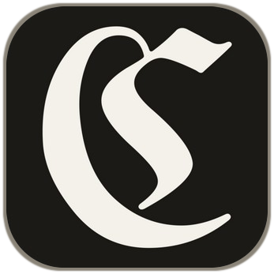

<h1 align="center">Cathedral Sandbox</h1>

<em>Cathedral&ensp;turns&ensp;independently&ensp;operated&ensp;machines&ensp;into&ensp;a&ensp;verifiable&ensp;compute&ensp;network</em>

12 November 2026

> [!IMPORTANT]
> **Compute mining is closed to new miners right now.** Only approved operators
> earn; any other machine earns nothing, even if it passes every check. There is
> no application. Cathedral will post an announcement when mining opens.
> **Earn today with no hardware:** the [Cathedral Escape Room](https://github.com/cathedralai/cathedral-escape-room)
> is open to any hotkey registered on SN94.

## Contents

<strong>Overview</strong> 
<strong>1. <a href="#how-mining-works">How mining works</a></strong> 
<strong>2. <a href="#current-support">Current support</a></strong> 
<strong>3. <a href="#customer-products">Customer products</a></strong>  
<strong>Operator path</strong> 
<strong>4. <a href="#what-you-need">What you need</a></strong> 
<strong>5. <a href="#install-and-start">Install and start</a></strong> 
<strong>6. <a href="#verify">Verify</a></strong> 
<strong>7. <a href="#founding-miners">Founding miners</a></strong> 
<strong>8. <a href="#validators">Validators</a></strong>  
<strong>Support</strong> 
<strong>9. <a href="#stop-and-get-help">Stop and get help</a></strong> 
<strong>10. <a href="#public-leak-guard">Public leak guard</a></strong>

Cathedral turns independently operated machines from trusted operators into a
verifiable compute network. Miners supply the machines; validators check their
confidential-computing evidence, test their work and score the results.

## The Cathedral map

| Repository | What it is | Read it when |
|---|---|---|
| **cathedral-sandbox** (this one) | The sandbox, the sealed host code, and compute mining | You want to mine with a machine, or study the target |
| [cathedral-escape-room](https://github.com/cathedralai/cathedral-escape-room) | The contest: break out of a sealed sandbox, prove it, earn | You want to attack the sandbox for a reward |
| [cathedral-validator](https://github.com/cathedralai/cathedral-validator) | The SN94 validator: how weights are set, with signed updates | You want to validate, or check how miners and breaks are paid |

This repository is for miners running compute workers on Bittensor SN94. It builds the wall, the escape room pays people to break it, and the validator pays both:
about 10% of its weight to approved compute miners, about 10% to proven escapes, and the rest is burned.

## How mining works

Validators verify fresh machine evidence, bind it to the live HTTPS key, reject
duplicate machines, and run a bounded SAT task. Each distinct verified machine
adds to its UID's score, if the hotkey is on the approved list. The validator
does not use a weight relay.

Registration, uptime, an attestation quote or an advertised machine count alone
earns nothing. Verification alone earns nothing too: the hotkey must also be
approved ([Gated compute](https://github.com/cathedralai/cathedral-validator/blob/main/docs/GATED_COMPUTE.md)). Weight does not guarantee TAO: the subnet needs positive emission.
This mining path is not a customer sandbox API.

## Current support

| Machine | Current boundary |
|---|---|
| AMD SEV-SNP guest | Validator source supports it. Each validator must admit the live measurement and TCB. SN94 admission remains unverified. |
| Intel TDX confidential VM | Mainnet live testing; fresh TDX evidence and SAT must pass. |
| More machines on one UID | Each must independently pass verification; duplicate hardware scores zero. |
| GPU | Not a qualified mining path; see the [development contract](docs/GPU_WORK.md). |

A machine quote does not remotely prove its container image digest or continuous
runtime integrity after boot. See the [mining guide](docs/MINING.md#current-support)
for the exact evidence boundary.

## Customer products

Cathedral's lease and sandbox products are live on SN94. The public sealed
tier runs on AMD SEV-SNP hosts that Cathedral leases. Cathedral does not own
those hosts. There is no self-serve sealed capacity; access is by request.
This repository does not sell or provision that product.

The Escape Room is open, with no cash prize. Rules and a practice harness are in
[cathedral-escape-room](https://github.com/cathedralai/cathedral-escape-room).

## What you need

- A Linux AMD SEV-SNP guest with `/dev/sev-guest`, or an Intel TDX VM with
  `/sys/kernel/config/tsm/report`. Ordinary SEV and a vTPM are not SNP.
- Python 3.12 with `venv`, Git, Docker, `nft`, and `curl` inside the guest.
- Public IPv4 and inbound TCP `8081`.
- A miner-owned control host with Python 3.12 and Git to refresh signed
  validator-access snapshots.
- A public Bittensor hotkey; Bittensor CLI `11.1.0` on a separate wallet machine.

Keep the coldkey and wallet off every worker. Workers need only the public
hotkey; each creates its own TLS private key inside its confidential guest.
Check AMD's [socket policy](docs/AMD_SEV_SNP_FRIEND_TEST.md#socket-policy-and-hardware-identity)
with the validators you expect to score it before renting or registering.

## Install and start

Follow the single [mining guide](docs/MINING.md) in order:

1. [Rehearse locally](docs/MINING.md#rehearse-before-renting-or-registering)
   three times before spending or registering. Python 3.11+ is enough for this
   rehearsal; its synthetic evidence proves protocol wiring, not hardware.
2. Choose the [AMD SEV-SNP](docs/MINING.md#run-one-amd-sev-snp-machine) or
   [Intel TDX](docs/MINING.md#run-one-intel-tdx-machine) instructions.
   Use their pinned image and root-owned launcher; do not run a writable
   checkout as root.
3. Set up the miner-owned signer and
   [snapshot refresh](docs/MINING.md#2-refresh-validator-access-from-a-control-host).
   Keep its signing seed outside the Git checkout.
4. Start the worker and check the exact health response before
   [paid registration and axon announcement](docs/MINING.md#4-register-and-announce-the-hotkey).

The guide preserves the exact checksums, launch commands and access timers.
This is not a one-command unattended install: recurring secure snapshot
delivery and a process supervisor are required. Stop before registration if
either is missing.

## Verify

A local rehearsal pass, image checksum or health response is not evidence of
admission, weight or earnings. Follow
[Confirm chain state](docs/MINING.md#5-confirm-chain-state) to check registration
and the finalized weight row. There is no public validator-result feed yet;
ask the validator operator for the matching verification result.

For another machine on the same UID, follow
[Add more machines](docs/MINING.md#add-more-machines-to-one-uid).
Reuse the signer, not a second hotkey or a second signing key.

## Founding miners

Compute mining is gated and there is no application right now. Cathedral will post an announcement when mining opens.
Registration alone does not admit a machine to the sealed customer pool
or place customer jobs. See the [mining guide](docs/MINING.md#founding-miners).

## Validators

Do not install or run a validator from this repository. The operator guide,
signed installer, SNP policy template and weight-write runbook live in
[cathedral-validator](https://github.com/cathedralai/cathedral-validator).

## Stop and get help

Stop if a checksum, image label, TEE device check, health response, snapshot
refresh or rehearsal differs from the guide. Open an
[issue](https://github.com/cathedralai/cathedral-sandbox/issues)
with the repository commit, image digest, CPU/TEE type, failing step and
redacted output. Do not paste a coldkey, seed phrase, wallet file, snapshot
signing seed, TLS private key, bearer token, raw attestation report or
unredacted environment.

Detailed troubleshooting is in the
[mining guide](docs/MINING.md#stop-and-get-help).
Protocol and development references are in the [documentation map](docs/README.md).

## Public leak guard

This repository is public. The `Leak guard` check blocks public IP addresses,
secrets, supplier names and customer names in new lines, pull request text and
commit messages. [Public leak guard](docs/LEAK_GUARD.md) tells you what it
blocks, how to add a private term and how to allow a false positive.

License: [MIT](LICENSE).
